<a href="https://linktr.ee/datArtist">
  <picture>
    <source media="(prefers-color-scheme: dark)" srcset="./assets/hero-dark.svg">
    
  </picture>
</a>

  <a href="https://linktr.ee/datArtist"><picture><source media="(prefers-color-scheme: dark)" srcset="./assets/btn-work-dark.svg"></picture></a>
  <a href="https://x.com/datartist_io"><picture><source media="(prefers-color-scheme: dark)" srcset="./assets/btn-x-dark.svg"></picture></a>
  <a href="https://linktr.ee/datArtist"><picture><source media="(prefers-color-scheme: dark)" srcset="./assets/btn-links-dark.svg"></picture></a>
  <a href="mailto:oluwadare50josiah@gmail.com"><picture><source media="(prefers-color-scheme: dark)" srcset="./assets/btn-mail-dark.svg"></picture></a>

<a href="https://github.com/datArtist-io?tab=repositories">
  <picture>
    <source media="(prefers-color-scheme: dark)" srcset="./assets/card-dark.svg">
    
  </picture>
</a>

<picture>
  <source media="(prefers-color-scheme: dark)" srcset="./assets/contributions-dark.svg">
  
</picture>
