<a href="https://linktr.ee/datArtist">
  <picture>
    <source media="(prefers-color-scheme: dark)" srcset="./assets/hero-dark.svg">
    
  </picture>
</a>

  <a href="https://linktr.ee/datArtist"><picture><source media="(prefers-color-scheme: dark)" srcset="./assets/btn-work-dark.svg"></picture></a>
  <a href="https://x.com/datartist_io"><picture><source media="(prefers-color-scheme: dark)" srcset="./assets/btn-x-dark.svg"></picture></a>
  <a href="https://linktr.ee/datArtist"><picture><source media="(prefers-color-scheme: dark)" srcset="./assets/btn-links-dark.svg"></picture></a>
  <a href="mailto:oluwadare50josiah@gmail.com"><picture><source media="(prefers-color-scheme: dark)" srcset="./assets/btn-mail-dark.svg"></picture></a>

<a href="https://github.com/datArtist-io?tab=repositories">
  <picture>
    <source media="(prefers-color-scheme: dark)" srcset="./assets/card-dark.svg">
    
  </picture>
</a>

### Projects

| Project | What it is |
|---|---|
| [VocaLink](https://github.com/datArtist-io/VocaLink-discord-bot) | Live voice translation for Discord. Everyone in a call hears the others in their own language, about a second behind the speaker. TypeScript, Soniox, ElevenLabs. |
| [Backline](https://github.com/datArtist-io/backline) | AI travel agent: one sentence in, a trip matched to your taste, booked by AI phone calls and shown on a 3D globe. Next.js, Three.js. [backline.travel](https://backline.travel) |
| [Book translation engine](https://github.com/datArtist-io/book-translation-engine) | Translates Word documents into any language while keeping their formatting, with automated checks and human review. Python, FastAPI. |
| [WhatsApp receipt bot](https://github.com/datArtist-io/Whatsapp-Receipt-Bot) | Generates a PDF receipt for each sale and sends it to the customer on WhatsApp, from a sale form or Paystack and Flutterwave webhooks. Node.js. |
| [VocaLink site](https://github.com/datArtist-io/VocaLink) and [3D koi pond](https://github.com/datArtist-io/VocaLink_test) | Two landing pages for VocaLink: one with a working in-browser translator, one built as a Three.js pond. |

<picture>
  <source media="(prefers-color-scheme: dark)" srcset="./assets/contributions-dark.svg">
  
</picture>
